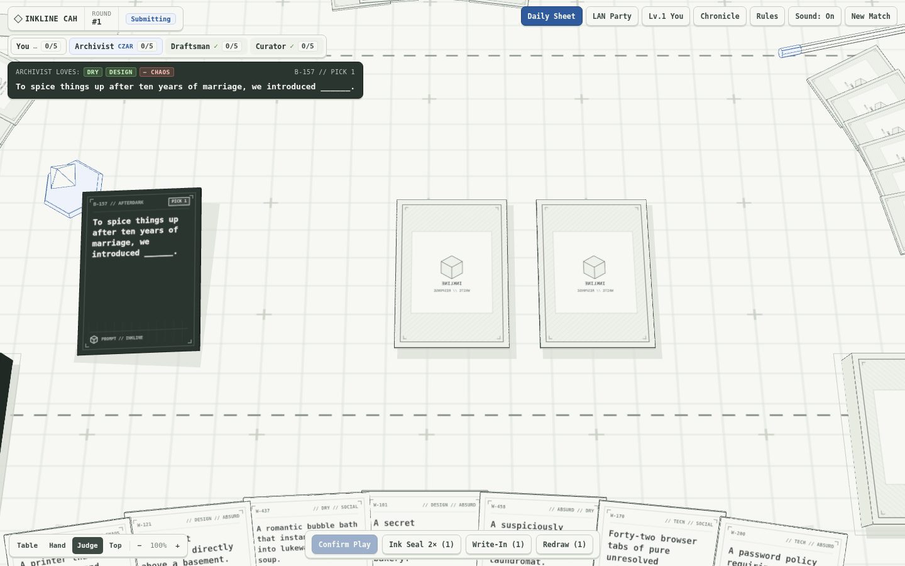
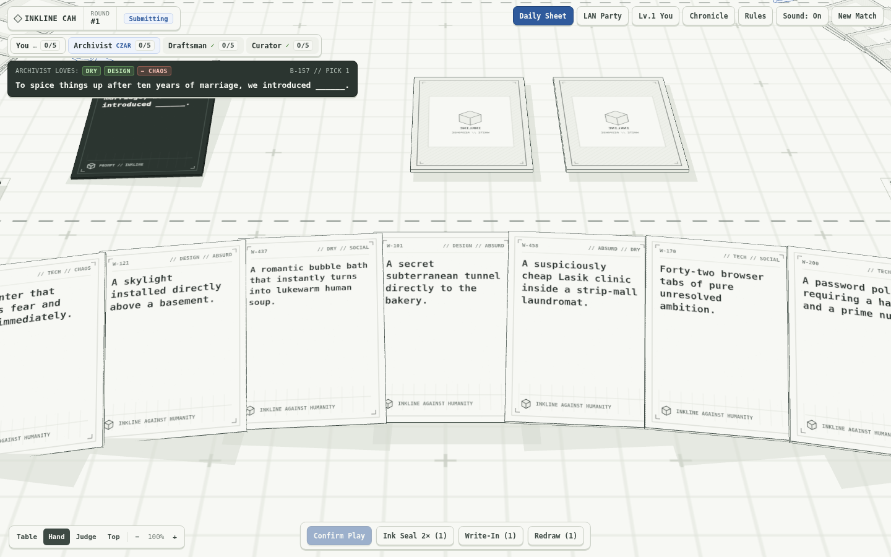

# Inkline Against Humanity

A card-party game on a 3D drafting table. Play prompt cards against witty written responses, win the Archivist's favour, and level up. Runs in the browser, no install.

### [▶ Play now](https://unrealumanga.github.io/inkline-cah/)




## Features
- Three.js table with an ink-and-blueprint look
- Bot opponents with their own tastes (the Archivist loves dry, design and chaos jokes)
- Power-ups: Ink Seal 2x, Write-In, Redraw
- Daily sheet, chronicle, levels
- LAN Party mode for local multiplayer (run `npm run lan`; not available on the hosted page)

## Run locally
```
npm install
npm run dev
```
